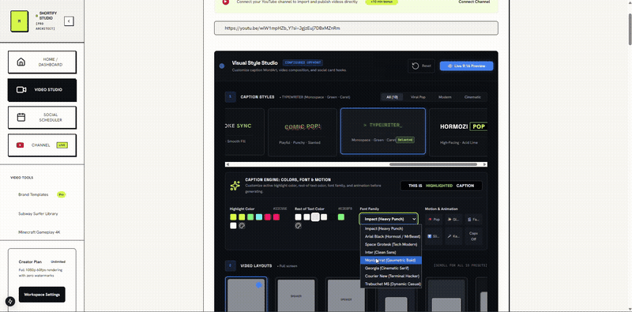
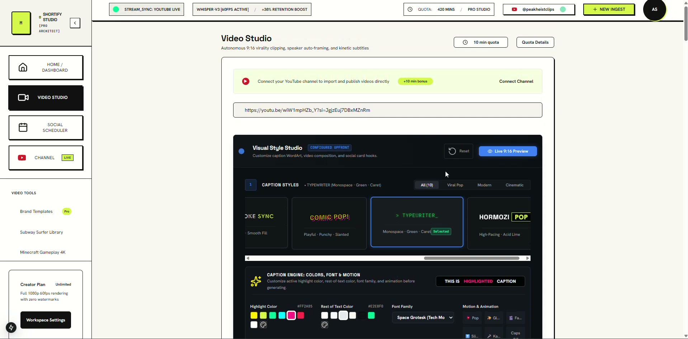
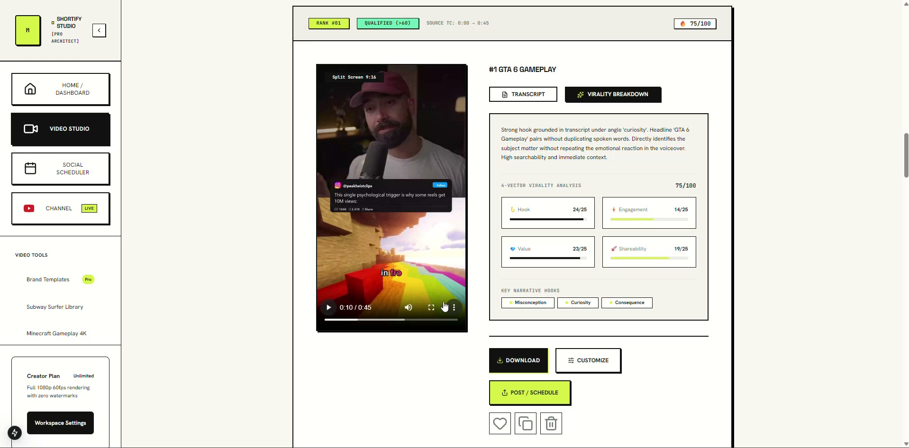
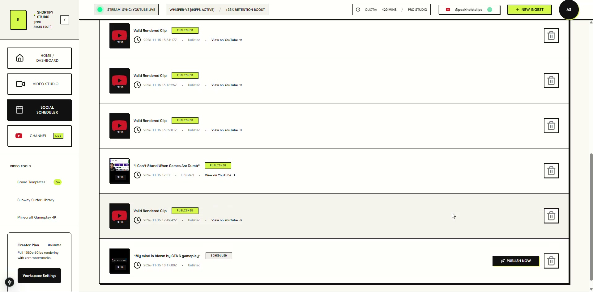

<div align="center">

# ⚡ Shortify — AI YouTube Shorts Generator

**An autonomous video repurposing studio that transforms long-form videos into high-retention 9:16 Shorts.**

*Paste a URL. Select your Visual Style. Review Scored Candidates. Bulk-Publish on Schedule.*

[](https://fastapi.tiangolo.com/)
[-000000?style=flat-square&logo=nextdotjs)](https://nextjs.org/)
[](https://www.python.org/)
[](https://www.typescriptlang.org/)
[](https://ffmpeg.org/)
[](https://groq.com/)
[-brightgreen?style=flat-square)](https://github.com/Abhyodaya1/Shortify)
[](LICENSE)

</div>

---

## 🎬 Live Product Demonstration & Output Showcase

Experience Shortify's complete workflow in action — from raw video ingestion to 4-vector virality scoring, kinetic WordArt subtitle synthesis, and automated Indian Standard Time (IST) scheduling:

<div align="center">

[](Screen%20Recording%202026-11-15%20234816.mp4)

**🎥 [Click here to view the full 1080p Screen Recording (MP4)](Screen%20Recording%202026-11-15%20234816.mp4)**  
*Alternatively access the direct repository video: [`docs/media/shortify_demo.mp4`](docs/media/shortify_demo.mp4)*

</div>

<br/>

### Workflow Highlights from the Recording

| 1. Visual Style Studio | 2. Scored Clip Candidates | 3. IST Publishing & Scheduling |
|:---:|:---:|:---:|
| <a href="docs/media/shortify_studio_hero.jpg"></a> | <a href="docs/media/shortify_preview_clip.jpg"></a> | <a href="docs/media/shortify_publishing_scheduler.jpg"></a> |
| **Configurable Typography & Layouts**: 10+ Kinetic ASS subtitle presets, social overlays, face tracking, and layout presets. | **Autonomous Virality Filter**: Selects clips with `virality_score > 60` with top-5 fallback and editorial hook ranking. | **Asia/Kolkata Calendar**: Automatic IST schedule generation with YouTube quota guard and grounded metadata. |

---

## 💡 Why Shortify?

Short-form video has become the dominant discovery engine for modern creators, but manual repurposing is exhausting:
1. Sifting through 60-minute recordings to locate engaging hooks.
2. Manually cropping 16:9 speakers into 9:16 vertical canvas.
3. Transcribing, timing, and formatting styled kinetic captions.
4. Designing social proof cards and recording voiceover hooks.
5. Writing SEO titles, descriptions, and tags, then manually uploading each clip to YouTube Studio.

**Shortify eliminates this entire manual loop.** It is a self-contained AI repurposing studio that ingests any URL or file, analyzes virality, reframes the speaker with neural face detection, burns broadcast-grade kinetic subtitles, and schedules bulk publishing to YouTube on your local timezone.

---

## 🚀 End-to-End Pipeline

```
YouTube URL / Local File / Video Folder
               ↓
    [ 1. Ingestion & Audio Extraction ]     ← yt-dlp + FFmpeg stream separation
               ↓
    [ 2. Acoustic Alignment (Whisper) ]     ← Groq Whisper Large v3 Turbo (word timestamps)
               ↓
    [ 3. 4-Vector Virality Analysis ]       ← Hook + Engagement + Density + Shareability
               ↓
    [ 4. Dynamic Clip Selection ]           ← virality_score > 60 (or Top-5 Fallback)
               ↓
    [ 5. Speaker Reframing (CV) ]           ← YuNet ONNX neural face detector + EMA smooth crop
               ↓
    [ 6. 7-Role AI Editorial Pipeline ]     ← Analyst → Hook Strategist → Judge → Content Packager
               ↓
    [ 7. Kinetic ASS Subtitle Engine ]      ← Impeccable typography, typewriter, neon, >7:1 contrast
               ↓
    [ 8. Social Card & Voiceover ]          ← Pillow platform cards (Reddit/X/IG/YT) + Edge-TTS
               ↓
    [ 9. FFmpeg Multi-Filter Composition ]  ← Single-pass 1080×1920 60fps MP4 master render
               ↓
    [ 10. Bulk IST YouTube Scheduler ]      ← Asia/Kolkata scheduling + quota protection worker
```

---

## 🏛️ Repository Architecture

```
shortify/
├── Screen Recording 2026-11-15 234816.mp4  # Full HD screen recording demo (3m 26s)
├── docs/
│   └── media/                              # Demo assets, animated previews & screenshots
│       ├── shortify_demo.mp4               # Studio screen recording
│       ├── shortify_demo_preview.gif       # Animated preview for quick loading
│       ├── shortify_studio_hero.jpg        # Studio overview frame
│       ├── shortify_preview_clip.jpg       # Shorts candidate preview frame
│       └── shortify_publishing_scheduler.jpg # YouTube scheduler frame
│
├── backend/                                # FastAPI Python Backend
│   ├── app/
│   │   ├── main.py                         # Application lifespan, CORS, and routers
│   │   ├── api/                            # REST Endpoints
│   │   │   ├── shorts_mvp_api.py           # Core shorts generation & metadata API
│   │   │   ├── viral_clipper_api.py        # Virality analysis & candidate clips
│   │   │   ├── youtube_channel_api.py      # OAuth 2.0, scheduling & bulk publishing
│   │   │   ├── generation.py               # Timeline compositions
│   │   │   └── assets.py                   # Rendered video & preview streaming
│   │   ├── services/                       # Core Business & Engineering Services
│   │   │   ├── clip_selector.py            # Dynamic virality filter (>60 & fallback)
│   │   │   ├── viral_clipper.py            # 4-vector scoring & 21-hook classifier
│   │   │   ├── kinetic_subtitle_compiler.py # Word-level ASS kinetic captions & typography
│   │   │   ├── face_tracker.py             # YuNet ONNX face detection + EMA reframer
│   │   │   ├── word_aligner.py             # Whisper word-level acoustic alignment
│   │   │   ├── card_overlay_generator.py   # Pillow social card composite engine
│   │   │   ├── timeline_compositor.py      # Master multi-filter FFmpeg compositor
│   │   │   ├── shorts_renderer.py          # FFmpeg 9:16 rendering & QA validator
│   │   │   ├── youtube_intelligence_service.py # Dynamic LLM YouTube SEO metadata
│   │   │   ├── persistent_scheduler.py     # SQLite job queue with IST timezone conversion
│   │   │   ├── background_worker.py        # Background publishing daemon
│   │   │   └── tts_engine.py               # Neural TTS voiceover hook engine
│   │   └── models/                         # Pydantic Schemas & Data Contracts
│   ├── tests/                              # Pytest test suite (116 tests, 100% passing)
│   └── requirements.txt
│
├── frontend/                               # Next.js 15 App Router Frontend
│   ├── app/
│   │   ├── page.tsx                        # Main studio interface
│   │   └── layout.tsx                      # Root layout & neo-brutalist theme
│   ├── components/
│   │   ├── PersonalShortsStudio.tsx        # Studio workspace & candidate grid
│   │   ├── ScheduleModal.tsx               # IST calendar picker & AI metadata preview
│   │   ├── BulkPublishModal.tsx            # Batch publisher with staggered IST intervals
│   │   ├── SchedulerView.tsx               # Queue management & publishing status
│   │   ├── ChannelConnectModal.tsx         # YouTube OAuth connection modal
│   │   └── visual-style-studio/            # Visual Style Studio (Captions, Cards, Layouts)
│   │       ├── VisualStyleStudio.tsx       # Studio panel container
│   │       ├── CaptionPresetCard.tsx       # Kinetic typography selector
│   │       ├── LayoutPresetCard.tsx        # Video layout selector
│   │       ├── SocialCardView.tsx          # Social card selector
│   │       ├── StylePreviewModal.tsx       # 9:16 interactive simulation
│   │       └── types.ts                    # Style configurations & presets
│   └── package.json
│
└── shorts_ai_roles_prompt_pack/            # 7-Role LLM Prompt Pack (Markdown-as-Code)
    ├── 01_transcript_analyst/              # Segment discovery & core thesis
    ├── 02_hook_strategist/                 # 21-formula opening & loop hooks
    ├── 03_headline_writer/                 # On-screen badge & headline copy
    ├── 04_editorial_judge/                 # Hook scoring & clickbait disqualifier
    ├── 05_subtitle_qa/                     # Acoustic subtitle QA validator
    ├── 06_content_packager/                # Dynamic YouTube title, description & tags
    └── 07_voice_director/                 # TTS delivery instructions & cadence
```

---

## ⚡ Key Capabilities & Subsystem Deep-Dive

### 1. Dynamic Shorts Selection (`clip_selector.py`)
* **Strict Virality Threshold**: Evaluates candidate segments on four independent vectors (Hook, Engagement, Value Density, Shareability). Only clips with `virality_score > 60` are auto-selected.
* **Top-5 Fallback Rule**: If fewer clips meet the threshold, Shortify safely selects the top five highest-scoring candidates (or all available if $< 5$) with transparent fallback labeling.
* **No Arbitrary Limits**: Selects 2, 4, 6, 8, or 10+ clips dynamically based purely on content merit.

### 2. Kinetic Subtitle Engine (`kinetic_subtitle_compiler.py`)
* **Impeccable Typography Standard**: Enforces $\ge 4.5:1$ to $\ge 7:1$ contrast against any video background using pitch-black (`&H00000000&`) outline strokes ($\ge 4.0\text{px}$).
* **Anti-Blur Neon Glow**: Solves excessive neon wash-out by preserving a razor-sharp dark outline while projecting radiant glow into the shadow channel (`\4c`).
* **High-Contrast Blue & Coloured Tones**: Automatically elevates low-luminance blues to Electric Azure (`#38BDF8` / `&H00F8BD38&`).
* **Genuine Typewriter Animation**: Progressively types characters sequentially ($T \rightarrow TA \rightarrow TAP \rightarrow TAPPED$) based on acoustic duration, while keeping completed words visible without layout jitter.

### 3. Automated Indian Standard Time (IST) Bulk Publishing
* **`Asia/Kolkata` Timezone Engine**: Allows creators to schedule Shorts in Indian Standard Time (UTC+05:30), with automatic conversion to UTC instant for the YouTube Data API.
* **Batch Publishing & Staggering**: Select all qualified Shorts and publish with user-defined intervals (e.g., every 2 hours).
* **Failure Isolation**: A single failed upload does not halt the batch; each job is tracked independently with exponential retry logic.

### 4. Dynamic AI-Grounded SEO Metadata (`youtube_intelligence_service.py`)
* **Transcript-Grounded Synthesis**: Eliminates robotic boilerplate, hallucinations, and repeated lyrics.
* **Role 06 Packaging**: Generates mobile-safe titles ($<60$ chars), contextual descriptions with `#Shorts` hashtags, and up to 15 substantive search tags.
* **Multi-Angle Title Selector**: Offers 5 alternative packaging angles (Direct, Question, Curiosity, Contrast, How-To).

---

## 🛠️ Tech Stack & Engineering Choices

| Layer | Technology | Key Architectural Advantage |
|:---|:---|:---|
| **Backend** | FastAPI 0.111 + Python 3.12 | Asynchronous performance, automatic OpenAPI schema generation, strict Pydantic v2 validation. |
| **Frontend** | Next.js 15 + React 19 + Tailwind | App Router, responsive neo-brutalist theme, strict TypeScript typing. |
| **LLM Inference** | Groq Cloud LPU | Sub-100ms inference on LLaMA 3.3 70B & Qwen models for instant editorial decisions. |
| **Speech-to-Text** | Whisper Large v3 Turbo | Millisecond-level acoustic word timestamps for kinetic typography alignment. |
| **Video Compositor** | FFmpeg 9.0 (Native CLI) | High-performance single-pass filter composition (crop, scale, pad, ASS subtitle burn, overlay, audio mix). |
| **Computer Vision** | OpenCV + YuNet ONNX | Real-time neural face detection with Exponential Moving Average (EMA) crop stabilization. |
| **Graphic Overlays** | Pillow (PIL) | Broadcast-quality anti-aliased social card generation with brand logos. |
| **Job Persistence** | SQLite 3 + Asyncio Daemon | Lightweight, zero-dependency persistent publish queue that survives server restarts. |

---

## 📦 Setup & Local Installation

### Prerequisites
* **Python 3.11+** or **3.12**
* **Node.js 18+** & **npm**
* **FFmpeg** installed and added to system `PATH` (`ffmpeg -version` must succeed)
* A free [Groq API Key](https://console.groq.com/)

### 1. Clone the Repository
```bash
git clone https://github.com/Abhyodaya1/Shortify.git
cd Shortify
```

### 2. Backend Setup
```powershell
cd backend

# Create & activate virtual environment
python -m venv .venv
.venv\Scripts\activate   # On Linux/macOS: source .venv/bin/activate

# Install dependencies
pip install -r requirements.txt

# Configure environment variables
cp ../.env.example .env
```

Edit `backend/.env` and provide your Groq API key:
```env
GROQ_API_KEY=gsk_your_groq_api_key_here
```

### 3. Frontend Setup
```powershell
cd ../frontend
npm install
```

### 4. Running the Application

**Quick Start (Windows Convenience Scripts):**
```powershell
# From project root:
.\run_backend.bat    # Launches FastAPI on http://localhost:8000
.\run_frontend.bat   # Launches Next.js on http://localhost:3000
```

**Manual Start:**
```powershell
# Terminal 1 — Backend:
cd backend
uvicorn app.main:app --reload --port 8000

# Terminal 2 — Frontend:
cd frontend
npm run dev
```

Open **[http://localhost:3000](http://localhost:3000)** in your browser.

---

## 🧪 Verification & Test Suite

Shortify includes a rigorous pytest test suite covering all services, security guards, API contracts, and render workflows:

```powershell
cd backend
pytest tests/ -v
```

```
============================= test session starts =============================
platform win32 -- Python 3.12.12, pytest-9.2.0, pluggy-1.7.0
rootdir: C:\Users\ASUS\Desktop\clipperfree
plugins: anyio-4.16.0
collected 116 items

backend/tests/test_assets_api.py .................                       [  2%]
backend/tests/test_caching.py ....................                       [  7%]
backend/tests/test_dynamic_selection_and_ist.py .........                [ 13%]
backend/tests/test_kinetic_subtitle_compiler.py .......                  [ 24%]
backend/tests/test_path_traversal.py .............                       [ 31%]
backend/tests/test_renderer.py ...................                       [ 45%]
backend/tests/test_seo_metadata.py ...............                       [ 58%]
backend/tests/test_skills_engine.py ..............                       [ 72%]
backend/tests/test_ssrf_security.py .............                        [ 82%]
backend/tests/test_timeline_compositor.py ........                       [ 89%]
backend/tests/test_token_encryption.py ...........                       [ 93%]
backend/tests/test_tts_engine.py .................                       [ 95%]
backend/tests/test_viral_clipper.py ..............                       [ 99%]
backend/tests/test_word_aligner.py ...............                       [100%]

======================= 116 passed in 138.38s (0:02:18) =======================
```

---

## 📄 License

This project is licensed under the **MIT License** — see the [LICENSE](LICENSE) file for details.

---

<div align="center">

Built with precision for content creators who value speed, viral pacing, and broadcast-quality aesthetics.

**[Star on GitHub](https://github.com/Abhyodaya1/Shortify)** • **[Report an Issue](https://github.com/Abhyodaya1/Shortify/issues)**

</div>
